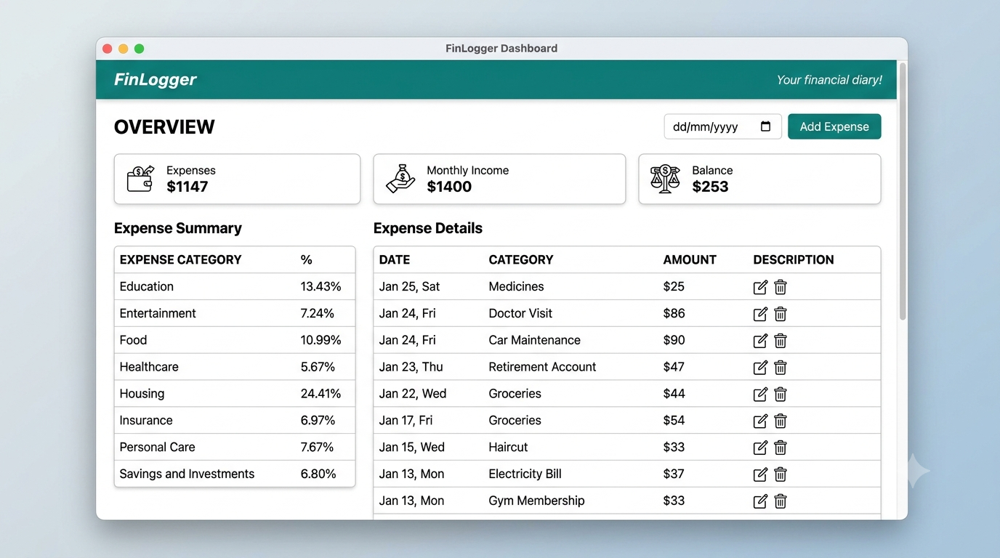

# FinLogger — Your Financial Diary!

A clean, responsive personal finance and expense-tracking web application built to log daily transactions, monitor monthly budgets, and visualize category-wise spending breakdowns.



## Features

* **Financial Overview Cards:** At-a-glance tracking for **Total Expenses**, **Monthly Income**, and **Remaining Balance**.
* **Expense Summary Breakdown:** Automatically calculates and displays percentage distributions across 10 core spending categories (Housing, Education, Food, Transportation, Personal Care, Entertainment, Utilities, Insurance, Savings & Investments, and Healthcare).
* **Detailed Transaction Log:** Chronological expense table displaying transaction dates, sub-categories, amounts, and quick-action **Edit** and **Delete** controls.
* **Add Expense Modal & Date Filtering:** Interactive controls to filter records by date (`dd/mm/yyyy`) and add new expenses seamlessly.
* **Responsive Layout:** Mobile-first, clean UI designed for readability across desktop and mobile viewports.

---

## Tech Stack

* **Frontend:** HTML5, CSS3, Bootstrap 5.3.3
* **Scripting & Logic:** Vanilla JavaScript (ES6+)
* **Icons & UI:** Custom SVG/Iconography & Responsive Grid/Flexbox Layouts

---

## Getting Started

To run this project locally on your machine:

1. **Clone the repository**
   ```bash
   git clone [https://github.com/sour413/Finlogger.git](https://github.com/sour413/Finlogger.git)

## Project Structure   
Finlogger/
├── dashboard.html      # Main dashboard UI (Overview, Summary, Details)
├── css/                # Custom stylesheets and Bootstrap overrides
├── js/                 # DOM manipulation, calculations, and CRUD logic
├── assets/             # Icons, logos, and screenshots
└── README.md           # Project documentation

## Future Enhancements
 Persistent Storage / Backend Integration: Connect to a Node.js/Express REST API with MongoDB or localStorage for data persistence.

 Interactive Charts: Add visual pie/bar charts using Chart.js for spending trends.

 CSV / PDF Export: Allow users to download monthly financial statements.
